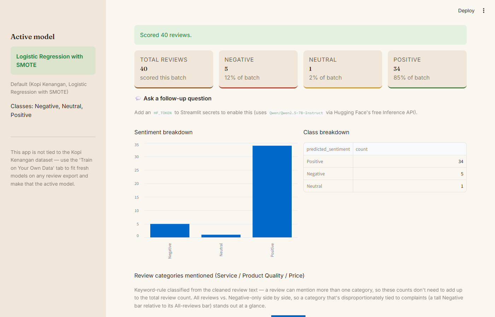
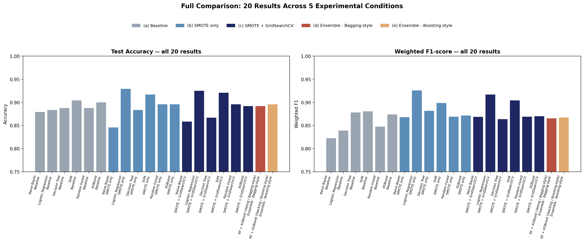
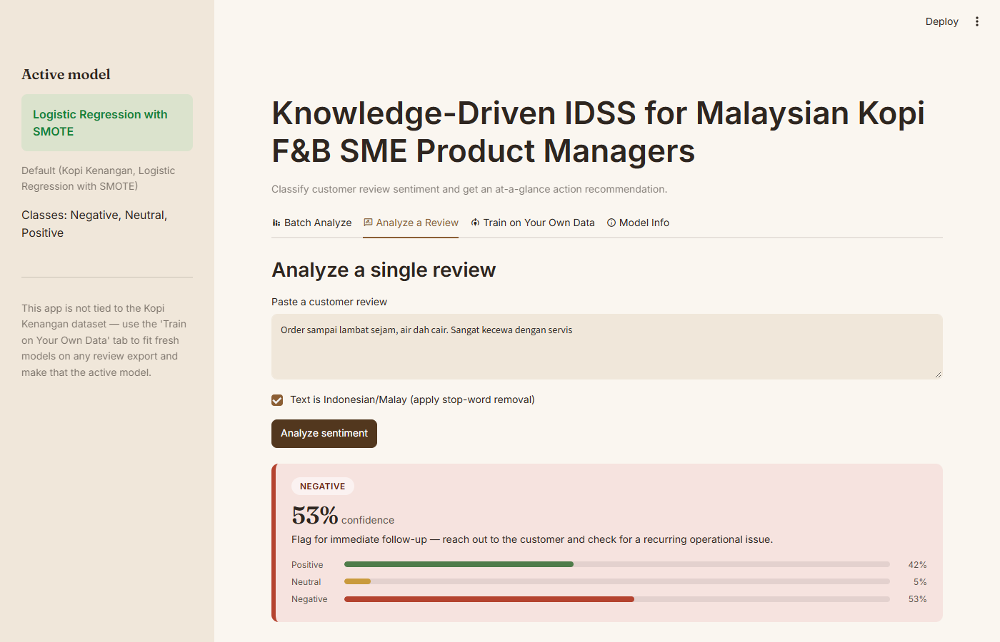
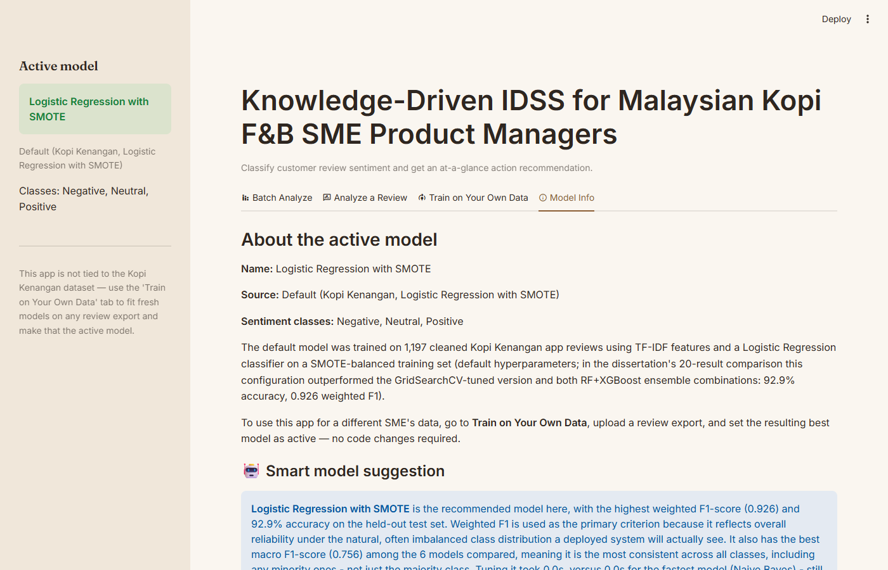

# Kopi sentiment analysis and decision support (IDSS)

Showcase code for my Master of Data Science dissertation, *Machine Learning-Based Sentiment Analysis for an Intelligent Decision Support System in Malaysian Kopi F&B SMEs*, supervised by Ts Dr Ahmad Faiz Mohd Ghazali at UiTM.

It classifies the sentiment of informal, code-switched customer reviews and turns the results into a Streamlit decision-support app for small F&B businesses. The app has an optional LLM analyst built on Qwen 2.5 7B.

**Try it:** [idss.nabil-takiyuddin.dev](https://idss.nabil-takiyuddin.dev) (fast web version on Vercel) or the [Streamlit app](https://kopi-sentiment-idss.streamlit.app/) (includes retraining on your own data)

**Case study:** [nabil-takiyuddin.dev/projects/kopi-sentiment-idss](https://nabil-takiyuddin.dev/projects/kopi-sentiment-idss)



## The problem

Independent kopi (coffee) F&B SMEs make up most of Malaysia's F&B establishments. Their customers post reviews all the time, but the reviews are short, informal, and mix Malay or Indonesian with English, which makes them hard to read at scale. Owners have no practical way to see what customers are unhappy about and what to fix first.

This project asks whether machine-learning sentiment analysis can turn those reviews into an intelligent decision support system (IDSS), using Kopi Kenangan app reviews as the case study.

## Approach

1. **Data.** 1,347 Google Play reviews of the Kopi Kenangan app. After deduplication and cleaning, 1,197 remained, labelled from star ratings: 1–2 is Negative, 3 is Neutral, 4–5 is Positive. The classes are heavily imbalanced: 1,054 Positive, 117 Negative and 26 Neutral.
2. **Pre-processing.** Lower-casing, URL and symbol removal, and Sastrawi stop-word removal for Malay and Indonesian, followed by TF-IDF on unigrams and bigrams (up to 3,000 features). The data was split 80/20, stratified, with `random_state=42`.
3. **Six classifiers.** Naive Bayes, Logistic Regression, Decision Tree, SVM, Random Forest and XGBoost.
4. **Five experimental conditions**, giving 20 model-condition results:

   | Condition | What changes |
   |---|---|
   | (a) Baseline | Default hyperparameters, imbalanced training data |
   | (b) SMOTE only | Training set oversampled with SMOTE |
   | (c) SMOTE + GridSearchCV | SMOTE plus stratified cross-validated hyperparameter tuning |
   | (d) Voting ensemble | Random Forest + XGBoost, soft voting |
   | (e) Stacking ensemble | Random Forest + XGBoost, stacked |

5. **Evaluation.** Accuracy, macro and weighted precision, recall and F1, and McNemar's test to check whether the best single model really beats the ensembles.

## Results

Logistic Regression trained on SMOTE-balanced data was the strongest model. With default hyperparameters it reached **92.9% accuracy** and 0.926 weighted F1. With GridSearchCV tuning it reached 92.5% accuracy. The untuned version is the one the app uses.

Best result in each condition (by weighted F1, held-out test set of 240 reviews):

| Condition | Best model | Accuracy | Macro F1 | Weighted F1 |
|---|---|---|---|---|
| (a) Baseline | SVM | 0.904 | 0.473 | 0.880 |
| **(b) SMOTE only** | **Logistic Regression** | **0.929** | **0.756** | **0.926** |
| (c) SMOTE + GridSearchCV | Logistic Regression | 0.925 | 0.688 | 0.917 |
| (d) Voting ensemble | RF + XGBoost | 0.892 | 0.429 | 0.866 |
| (e) Stacking ensemble | RF + XGBoost | 0.892 | 0.421 | 0.860 |

- SMOTE made the biggest difference. It roughly doubled macro F1 for Logistic Regression (0.362 to 0.756), so the minority Negative and Neutral classes became usable.
- Combining Random Forest and XGBoost did not help. McNemar's test shows tuned Logistic Regression beating both ensembles (p = 0.039 against voting, p = 0.021 against stacking).
- All 20 results are in [`outputs/tables/extended_20_results/master_20_results.csv`](outputs/tables/extended_20_results/master_20_results.csv).



## The decision-support app

The Streamlit app wraps the model in four tabs:

- **Batch Analyze.** Upload a CSV or XLSX of reviews to get sentiment counts, a breakdown by Service, Product Quality and Price, the top terms per sentiment, and the most negative reviews to follow up.
- **Analyze a Review.** Classify one review, with class probabilities and a recommended action.
- **Train on Your Own Data.** Upload any review export with ratings or labels, retrain all six classifiers (with optional SMOTE and tuning), compare them, and make the best one the active model. No code changes are needed.
- **Model Info.** Details of the active model and a plain-language explanation of why it was chosen.

With a Hugging Face token, the app also writes a short **AI insights brief** for each batch and answers **follow-up questions** grounded only in the statistics on screen. Both use `Qwen/Qwen2.5-7B-Instruct` through the Hugging Face Inference API. Without a token, these features stay switched off and everything else still works.

| Analyze a review | Model info |
|---|---|
|  |  |

## Tech stack

Python, pandas, scikit-learn, XGBoost, imbalanced-learn (SMOTE), Sastrawi, statsmodels (McNemar's test), matplotlib, seaborn, Streamlit, and Qwen 2.5 7B Instruct via `huggingface_hub`.

## Run it locally

Requires Python 3.11 or newer.

```bash
git clone https://github.com/nabiledler92/IDSS-sentiment-showcase.git
cd IDSS-sentiment-showcase
python -m venv .venv
# Windows: .venv\Scripts\activate    macOS/Linux: source .venv/bin/activate
pip install -r requirements.txt
streamlit run app.py
```

The pre-trained model in `models/` loads automatically. To try the Batch Analyze tab, upload [`data/sample_reviews_synthetic.csv`](data/sample_reviews_synthetic.csv) and pick `review_text` as the text column.

**Optional AI features:** copy `.streamlit/secrets.toml.example` to `.streamlit/secrets.toml`, or `.env.example` to `.env` and export the variable. Then add a free Hugging Face "Read" token as `HF_TOKEN`. Both files are gitignored. Never commit a real token.

## Data

The original dataset was scraped from public Google Play reviews and is **not included**, because it contains reviewers' names and profile details. This repository contains:

- **`data/sample_reviews_synthetic.csv`**: 40 invented, code-switched reviews with star ratings, written for this repo so the app can be tried. They are not real customer reviews.
- **The trained model artifacts and all aggregate results** (metrics, tables and charts). None of these contain review text.

To reproduce the experiments with your own data:

1. Collect reviews for any app with [`google-play-scraper`](https://pypi.org/project/google-play-scraper/), using the app ID from its Play Store URL. Keep at least the `reviewId`, `content` and `score` columns.
2. Save them as `data/KopiKenangan_appreviews.xlsx` with a sheet named `kopken_dataset`, or change the path at the top of the scripts.
3. Install the extra packages with `pip install -r requirements-notebook.txt`, then run the notebook or the staged scripts in [`notebooks/extended_20_results/`](notebooks/extended_20_results/README.md).

Alternatively, use the app's **Train on Your Own Data** tab, which needs no code at all.

## Repository layout

```
app.py                     Streamlit IDSS app
app_pipeline.py            Shared cleaning, training and prediction pipeline
models/                    Deployed model, TF-IDF vectorizer, label encoder, and all 6 classifiers
notebooks/
  Kopi_Kenangan_Sentiment_Model.ipynb   End-to-end pipeline: data, EDA, models, best model
  extended_20_results/                  Five staged scripts for the 20-result comparison
outputs/figures/           Charts (EDA, confusion matrices, model comparisons)
outputs/tables/            Metrics tables (CSV/JSON), no review text
data/                      Synthetic sample only (see "Data")
docs/screenshots/          App screenshots
web/                       Vercel version: Next.js frontend + FastAPI backend (see web/README.md)
```

## Limitations

- The model learned from one brand's app reviews, which are mostly positive. On other businesses' reviews it leans towards Positive, so retrain it in the app for a new business.
- Only 26 Neutral examples were available, so Neutral is the weakest class.
- Labels come from star ratings, not manual annotation, so they include some noise (for example, a 5-star review with a complaint in it).
